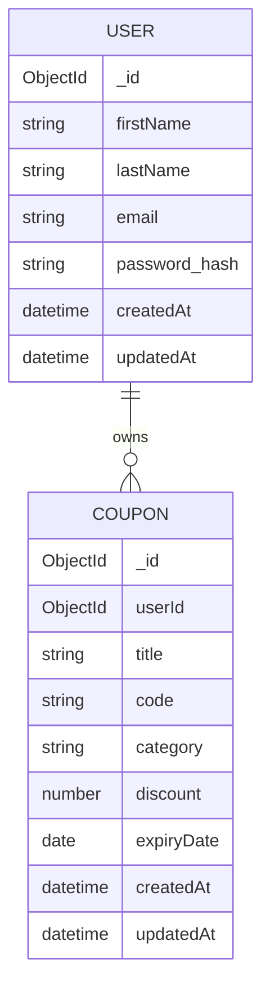
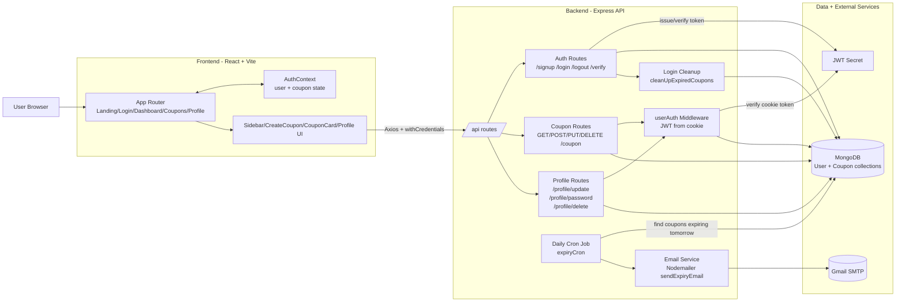

# CUPPU — Digital Coupon Organizer

CUPPU is a full-stack coupon management app for storing, organizing, filtering, and tracking coupon expiry dates. It includes secure cookie-based authentication, coupon CRUD operations, profile management, and automated coupon expiry workflows.

## Repository Structure

```text
coupon-organizer/
├── backend/                  # Express + MongoDB API
│   ├── src/
│   │   ├── app.js            # App bootstrap, middleware, routes, DB + cron startup
│   │   ├── config/db.js      # MongoDB connection
│   │   ├── middlewares/      # Auth middleware
│   │   ├── models/           # Mongoose User and Coupon models
│   │   ├── routes/           # Auth, coupon, profile APIs
│   │   └── utils/            # Validation, JWT, cleanup, cron, email helpers
│   └── .env.example          # Required backend environment variables
├── frontend/                 # React + Vite client
│   ├── src/
│   │   ├── pages/            # Landing, Login, Dashboard, Coupons, Profile, 404
│   │   ├── components/       # Reusable UI + coupon modal/card components
│   │   ├── context/          # Global auth/coupon state
│   │   ├── hooks/            # Password validation hook
│   │   ├── config/           # API base URL + Zod schema
│   │   └── icons/            # SVG icon components
│   └── vercel.json           # SPA routing rewrites
└── readme.md                 # Project documentation
```

## Tech Stack

### Frontend
- React 19 + React Router
- Vite (rolldown-vite)
- Tailwind CSS 4
- Axios
- React Toastify
- Zod

### Backend
- Node.js + Express 5
- MongoDB + Mongoose
- JWT + cookie-based auth
- bcrypt password hashing
- node-cron scheduled jobs
- nodemailer email notifications
- validator input validation

## Core Features

- User signup/login/logout with HTTP-only cookies
- Session verification endpoint for client auth restore
- Create, read, update, and delete personal coupons
- Coupon filtering by active/expired state, category, and expiry date
- Dashboard metrics and “expiring soon” highlight list
- Profile updates (name, password, account deletion)
- Auto-cleanup of coupons expired for more than 3 days (on login)
- Daily cron-based email alerts for coupons expiring tomorrow

## How the App Works

1. User authenticates via `/api/signup` or `/api/login`.
2. Backend sets a secure `token` cookie.
3. Frontend verifies user via `/api/verify` and loads coupons.
4. Coupon state is stored in `AuthContext` and used across dashboard, list, and profile.
5. `userAuth` middleware protects coupon/profile routes.
6. Cron job runs daily and emails grouped expiry alerts.

## Database Architecture (Mermaid)



## System Architecture (Mermaid)



## Backend API Reference

Base path: `/api`

### Auth Routes
- `POST /signup` — register user
- `POST /login` — login user
- `POST /logout` — clear auth cookie
- `GET /verify` — validate cookie and return user

### Coupon Routes (Authenticated)
- `GET /coupon` — list current user coupons (sorted by expiry)
- `POST /coupon` — create coupon
- `PUT /coupon/:id` — update coupon title/code/discount
- `DELETE /coupon/:id` — delete coupon

### Profile Routes (Authenticated)
- `POST /profile/update` — update first and last name
- `POST /profile/password` — change password and invalidate session
- `DELETE /profile/delete` — delete account and associated coupons

## Environment Variables (Backend)

Use `backend/.env.example`:

- `MONGO_URI` — MongoDB connection string
- `PORT` — backend server port (commonly `3000`)
- `SECRET` — JWT signing secret
- `EMAIL_USER` — sender Gmail address for cron alerts
- `EMAIL_PASS` — Gmail app password

## Local Development Setup

### Prerequisites
- Node.js (LTS recommended)
- npm
- MongoDB instance

### 1) Install dependencies

```bash
npm --prefix frontend ci
npm --prefix backend ci
```

### 2) Configure backend env

Create `backend/.env` using `backend/.env.example`.

### 3) Start backend

```bash
npm --prefix backend run dev
```

### 4) Start frontend

```bash
npm --prefix frontend run dev
```

Frontend typically runs on `http://localhost:5173`.

## Available Scripts

### Frontend (`frontend/package.json`)
- `npm run dev` — start Vite dev server
- `npm run build` — production build
- `npm run lint` — ESLint
- `npm run preview` — preview production build

### Backend (`backend/package.json`)
- `npm run dev` — start with nodemon
- `npm run start` — start with node
- `npm test` — placeholder script (currently exits with error)

## Deployment Notes

- Frontend config includes Vercel SPA rewrite (`frontend/vercel.json`).
- Backend CORS currently allows `https://coupon-organizer.vercel.app` with credentials.
- Frontend `BASE_URL` is currently set to `https://coupon-organizer.onrender.com/api`.

## 👨‍💻 Project Maintainer
**Akash Kumar**  
*Full Stack Developer*

- [GitHub](https://github.com/akash010220221)
- [LinkedIn](https://www.linkedin.com/in/akash0102/)
